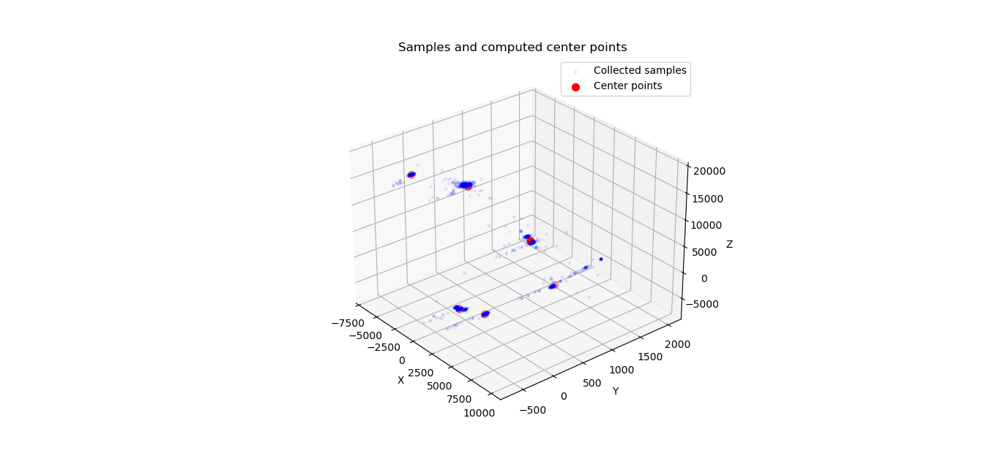
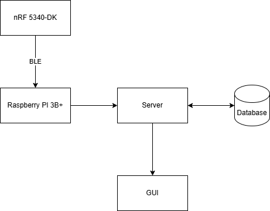

# Telecommunications project, Group 24

This repository contains the documentation and source code for the telecommunications project of Group 24 (Autumn 2025, Oulu University of Applied Sciences)

## System components

The project consists of the following software/hardware components:

    - Nordic Semiconductor nRF5340-DK (Bluetooth Low Energy Development Kit)
    - Raspberry Pi 3B+ (Ubuntu GNU/Linux recommended)
    - MPU6050 accelerometer/gyroscope module (GY-521 development module recommended)

## Features

    - Transmission/reception of gyroscope, accelerometer and button data over BLE
        The nRF device reads data from the gyroscope and/or the accelerometer and transmits it over BLE.
        The server application receives the data and stores it in the database for further processing. (WIP: move interrupt pin to non-conflicting GPIO)

    - Analysis of received accelerometer data with K-means clustering

    - Graphical User Interface (GUI)
        The data is displayed through a Web-based GUI hosted with the Apache server software running on the Raspberry Pi 3B+
        Users can view real-time accelerometer data from a standard web browser.

    - Sensor self-testing
    	The MPU6050 driver has been equipped with sensor self-tests according to the specifications of the manufacturer. (WIP, may break module configuration)

## usage

### nRF5340DK

- Clone this repository.
- Open the "nrf-sampling" directory with VSCode.
- Set the build configuration with the nRF Connect plugin (use Sysbuild).
- Ensure the the MPU6050 pin VCC is connected to a 3.3 volt power supply, SCL is connected to P1.03, SDA is connected to P1.02, INT is connected to P1.10 and AD0 is grounded to ensure address 0x68.
- Build and flash with the nRF Connect plugin

### Sample gathering

- After the nRF5340DK has been flashed, powered on and LED 0 (LED 1 on the circuit board) has turned off, run `python3 sample_gatherer.py`
- 800 samples will be gathered into samples.csv. As the project is designed to gather data from six different directions, move the samples.csv file to accel_dir[0-5].csv and rerun `python3 sample_gatherer.py` until you have six sample CSV files.
- run `python3 prunek.py` to get rid of timestamps and the header row.
- Run `python3 plotcalc.py` to plot samples and calculate center points. Rerun until sufficient center points have been calculated.
- Add the calculated center points in keskipiste.h (WIP: generate an OOTB header file) to the keskipiste.h file in the "nrf-sampling" directory.

## Dependencies

    - nRF SDK
    - Apache HTTP server
    - Bleak BLE library
    - Numpy, Matplotlib, pyserial (sampling, k-means analysis)

## Example samples and center points

## System Diagram

## Credits

Luukas Ahola, Lauri Knuuttila
